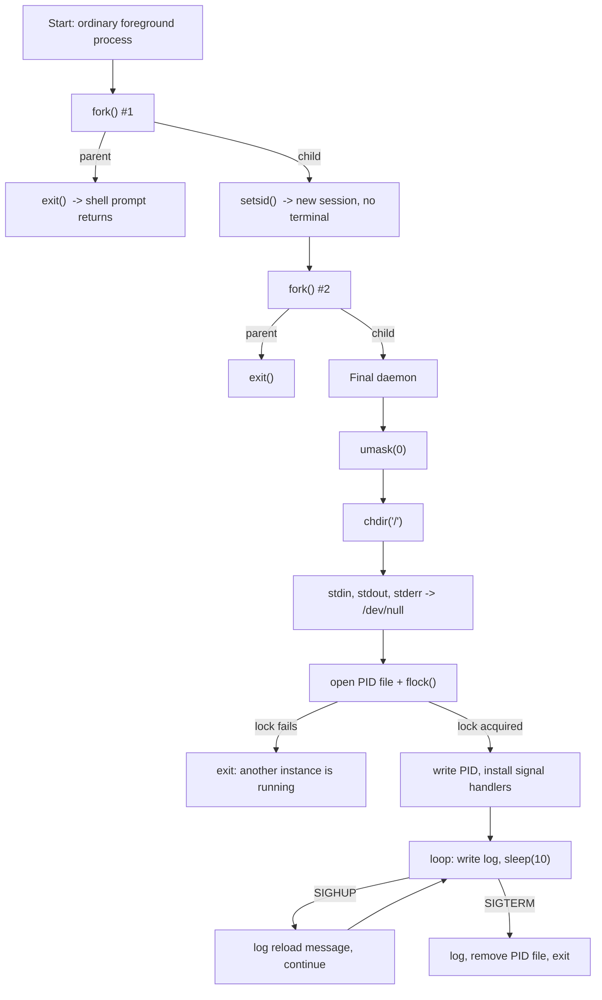
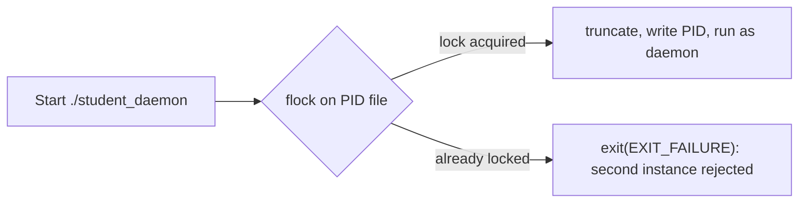

Linux Daemon Process (`student_daemon`)


A mini-project that builds a real Linux daemon in C using the classic double-fork sequence. The program detaches from the terminal, runs forever in the background, writes a heartbeat message to a log file, keeps a locked PID file so only one copy can run, and shuts down cleanly on `SIGTERM`.
---
Contents
Overview
Features
How the Daemon Is Created
Process IDs Before and After Daemonizing
Runtime Files
Build and Run
Usage
Sample Output
Signal Handling
Duplicate-Instance Protection
Test Cases
Things Worth Knowing
Known Limitations and Improvements
Project Structure
Author
Overview
A normal program is tied to the terminal that started it: close the terminal and the program usually dies. A daemon is a background service (like `sshd` or `cron`) that is independent of any terminal. This project shows, step by step, what a process must do to become one.
It is not just "run in the background". The program demonstrates the real mechanics: `fork`, `setsid`, `umask`, `chdir`, file-descriptor redirection, PID files, file locking and signal handling.
Features
Feature	How it is done
Detaches from the terminal	`fork()` then `setsid()`
Cannot re-acquire a terminal	Second `fork()`, final daemon is not a session leader
Runs continuously	Infinite loop with `sleep(10)`
Periodic logging	Appends `Daemon is running` to `/tmp/student_daemon.log` every 10 seconds
PID file	`/tmp/student_daemon.pid` holds the daemon's PID
Single instance only	`flock(LOCK_EX | LOCK_NB)` on the PID file
Graceful shutdown	`SIGTERM` logs a message, removes the PID file and exits
Reload event	`SIGHUP` logs a reload message and the daemon keeps running
No terminal dependency	`stdin`, `stdout`, `stderr` redirected to `/dev/null`
How the Daemon Is Created

Step	What the code does	Why it is needed
1	Start in `main()` as a normal process	Starting point, still attached to the terminal
2	First `fork()`, parent exits	Shell gets its prompt back. Child is adopted by init/systemd. Child is guaranteed not to be a process-group leader, so `setsid()` can succeed
3	`setsid()`	Creates a new session and detaches from the controlling terminal. Terminal signals (SIGHUP on close, Ctrl+C) no longer reach the process
4	Second `fork()`, parent exits	After `setsid()` the process is a session leader and could re-acquire a terminal by opening one. The final child is not a session leader, so it never can
5	`umask(0)`	Do not inherit the shell's file-creation mask. Files get exactly the permissions requested in `open()`
6	`chdir("/")`	Do not keep the launch directory busy (for example, blocking an unmount)
7	Redirect fds 0, 1, 2 to `/dev/null`	Daemon must not depend on, or write to, the launching terminal
8	Create PID file and lock it with `flock()`	Lets users find the daemon and prevents a second instance. The lock is released automatically when the process dies, so a stale PID file cannot block a restart
9	Register handlers for `SIGTERM` and `SIGHUP`	Clean shutdown and reload notification
10	Loop: append to log, `sleep(10)`	The daemon's continuous background work
Process IDs Before and After Daemonizing
Values from a real run (`ps -o pid,ppid,pgid,sid,tty,stat,cmd`):
Process	PID	PGID	SID	Meaning
Original process	216			Exits after the first fork
First child	217	217	217	PID = SID, so it is a session leader (after `setsid()`). Exits after the second fork
Final daemon	219	217	217	PID is different from SID, so it is not a session leader. PPID is 1 and TTY is `?`
Runtime Files
File	Purpose
`/tmp/student_daemon.pid`	Holds the daemon's PID. Locked with `flock()`. Removed on `SIGTERM`
`/tmp/student_daemon.log`	Heartbeat and signal messages, appended with `"a"` mode
Build and Run
Requirements: Linux, `gcc`.
```bash
gcc -Wall -Wextra -O2 student_daemon.c -o student_daemon
./student_daemon
```
The command returns immediately because the daemon has detached from your terminal.
Usage
```bash
# Find the daemon
pgrep -a -x student_daemon

# Show the stored PID
cat /tmp/student_daemon.pid

# Inspect its process properties
ps -o pid,ppid,pgid,sid,tty,stat,cmd -p $(cat /tmp/student_daemon.pid)

# Watch the log live
tail -f /tmp/student_daemon.log

# Send a reload event (daemon keeps running)
kill -HUP $(cat /tmp/student_daemon.pid)

# Stop the daemon gracefully
kill -TERM $(cat /tmp/student_daemon.pid)

# Check cleanup
pgrep -x student_daemon          # no output
ls /tmp/student_daemon.pid       # No such file or directory
```
Sample Output
Terminal output when launching (this is printed before the descriptors are redirected in Step 7; the order of lines can vary slightly):
```
Before fork
PID =216
PPID=204
parent process:PID=216
child process:PID=217
After setsid()
PID=217
PPID=1
PGID=217
SID=217
Final daemon:PID=219
old mask=022
new mask=000
current working directory=/
```
Daemon properties:
```
  PID  PPID  PGID   SID TT       STAT CMD
  219     1   217   217 ?        S    ./student_daemon
```
Daemon state checked through `/proc`:
```
Umask:  0000                       (umask(0) applied)
cwd  -> /                          (chdir("/") applied)
fd 0 -> /dev/null
fd 1 -> /dev/null
fd 2 -> /dev/null
fd 3 -> /tmp/student_daemon.pid    (PID file held open, carries the lock)
```
Log after a SIGHUP and then a SIGTERM:
```
Daemon is running
SIGHUP received -confirmation reloaded
Daemon is running
Daemon is running
SIGTERM received-daemon terminating
```
Signal Handling
Both signals are registered with `signal()` and handled by `handle_signal()`.
Signal	Sent with	What happens
`SIGTERM` (15)	`kill -TERM <PID>`	Logs `SIGTERM received-daemon terminating`, closes the log, removes the PID file, calls `exit(0)`. The lock is released when the process ends
`SIGHUP` (1)	`kill -HUP <PID>`	Logs `SIGHUP received -confirmation reloaded`. The daemon keeps running (the interrupted `sleep()` returns early)
Duplicate-Instance Protection
The daemon opens the PID file and requests an exclusive, non-blocking lock:
```c
pid_fd = open("/tmp/student_daemon.pid", O_RDWR|O_CREAT, 0666);
flock(pid_fd, LOCK_EX|LOCK_NB);   /* fails immediately if already locked */
```

Using `flock()` is more reliable than only checking whether the PID file exists. If the daemon crashes or is killed with `SIGKILL`, the kernel drops the lock, so a leftover PID file does not stop the next start.
Note: the second instance still forks and detaches first, then exits silently when the lock fails, because its output already goes to `/dev/null`. Verify with `pgrep -a -x student_daemon` that only the original PID remains.
Test Cases
ID	Test	Procedure	Expected result
TC01	Compilation	`gcc -Wall -Wextra -O2 student_daemon.c -o student_daemon`	Compiles without errors or warnings
TC02	Parent exit	`./student_daemon`	Shell prompt returns immediately
TC03	Daemon exists	`pgrep -a -x student_daemon`	One process found
TC04	Terminal detached	`ps -o tty -p <PID>`	TTY is `?`
TC05	Session behaviour	`ps -o pid,ppid,pgid,sid`	PID differs from SID, PPID is 1 (or a subreaper)
TC06	Logging	Wait 10 s, `cat` the log	New `Daemon is running` line

TC07	Continuous operation	Wait 30 s	Several entries, about one every 10 s
TC08	PID file	`cat /tmp/student_daemon.pid`	Correct PID
TC09	PID verification	`ps -p $(cat /tmp/student_daemon.pid)`	Process exists
TC10	SIGHUP	`kill -HUP <PID>`	Reload message logged, daemon still running
TC11	SIGTERM	`kill -TERM <PID>`	Termination message logged, process ends
TC12	Cleanup	`ls /tmp/student_daemon.pid`	File no longer exists
TC13	Restart	Run `./student_daemon` again	New daemon starts normally
TC14	Duplicate start	Run it while one is running	Second instance rejected, PID file unchanged
TC15	Terminal close	Close the launching terminal	Daemon keeps running
Things Worth Knowing
`printf` before the fork can appear twice if you redirect the launch output to a file (`./student_daemon > out.txt`). `stdout` becomes fully buffered, and the unflushed text is copied into the child by `fork()`. In a terminal (line-buffered) this does not happen.
The `printf` calls in Steps 1 to 6 are teaching aids. They are visible only because the descriptors are redirected later in Step 7. A production daemon would log to a file or `syslog` instead.
PPID is not always 1. On modern Linux an orphaned process may be adopted by a "subreaper" instead of PID 1. Focus on successful detachment, not a literal `1`.
Modern alternative: with systemd you can write a plain foreground service and let systemd supervise it, so double-forking is not required.
Known Limitations and Improvements
This version is a learning implementation. Planned improvements:
[ ] Signal-safe handlers. The handler currently calls `fopen`, `fprintf` and `exit`, which are not async-signal-safe. Set `volatile sig_atomic_t` flags in the handler (`running`, `reload_requested`) and do the logging in the main loop
[ ] Replace `signal()` with `sigaction()` for portable, well-defined behaviour
[ ] Use `exit(EXIT_FAILURE)` instead of `exit(0)` on the `setsid`, `chdir`, `getcwd` and `open` error paths
[ ] Create the PID file with mode `0644` (it is currently `0666`, writable by everyone), or use a restrictive `umask` such as `027`
[ ] Add a timestamp and PID to every log line
[ ] Replace `while(1)` with `while(running)` so the loop ends cleanly
[ ] Add a `Makefile`
[ ] Optional: run it as a systemd-managed foreground service and compare
Project Structure
```
linux-daemon/
|-- student_daemon.c    full daemon source (Steps 1 to 10)
`-- README.md
```
Author
Kranthi Kolli
